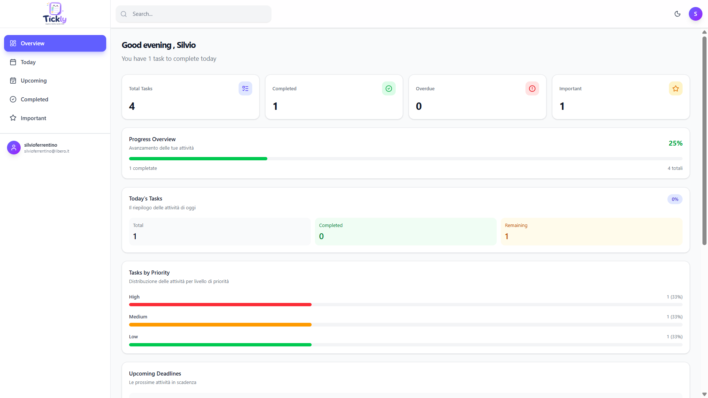

# Todo App Premium


<p align="center">
  
</p>

<p align="center">
  <a href="https://todo-app-premium-two.vercel.app/">
    <strong>Live Demo</strong>
  </a>
  ·
  <a href="https://github.com/SlvWebDeveloper/todo-app-premium">
    <strong>Source Code</strong>
  </a>
</p>


A modern task management web application built with React, Vite, Tailwind CSS, and Supabase. Organize daily tasks, track deadlines, manage priorities, and keep your data synchronized with a cloud database.

**Live Demo:** [Todo App Premium](https://todo-app-premium-two.vercel.app/)

**Repository:** [GitHub](https://github.com/SlvWebDeveloper/todo-app-premium)

## Features

- **Authentication** — Sign up and sign in with Supabase Auth.
- **Cloud database** — Store tasks in Supabase and retrieve them across sessions.
- **Task management** — Create, edit, and delete tasks.
- **Task status** — Mark tasks as completed or active.
- **Priority management** — Organize tasks by priority and mark important items.
- **Deadlines** — Assign dates and track upcoming or overdue tasks.
- **Search and filtering** — Find tasks quickly and filter them by status, priority, and other criteria.
- **Dashboard** — View task statistics, progress, and priority distribution.
- **Responsive sidebar** — Navigate between task views.
- **Dark mode** — Switch between light and dark themes.
- **Notifications** — Receive feedback when performing task actions.

## Tech Stack

| Technology | Purpose |
|---|---|
| React | Component-based user interface |
| Vite | Development server and build tooling |
| Tailwind CSS | Utility-first styling |
| JavaScript (ES6+) | Application logic |
| Supabase | Authentication, PostgreSQL database, and Row Level Security |
| React Router | Client-side routing |
| Lucide React | Icons |
| Vitest | Utility function testing |
| Vercel | Deployment and hosting |

## Getting Started

### Prerequisites

- Node.js and npm
- A Supabase account
- Git

### 1. Clone the repository

```bash
git clone https://github.com/SlvWebDeveloper/todo-app-premium.git
cd todo-app-premium
```

### 2. Install dependencies

```bash
npm install
```

### 3. Configure environment variables

Create a `.env.local` file in the project root:

```env
VITE_SUPABASE_URL=https://YOUR_PROJECT.supabase.co
VITE_SUPABASE_PUBLISHABLE_KEY=YOUR_SUPABASE_PUBLISHABLE_KEY
```

Replace the placeholder values with your own Supabase project URL and publishable key.

**Security:** Never commit `.env.local` or expose Supabase secret or service-role keys in frontend code.

### 4. Configure Supabase

Create a Supabase project and configure the authentication URL settings for your local development URL and deployed application URL.

Create the `tasks` table using the SQL Editor:

```sql
create table public.tasks (
  id uuid primary key default gen_random_uuid(),
  user_id uuid not null references auth.users(id) on delete cascade,
  title text not null,
  description text not null default '',
  date date,
  priority text not null default 'medium'
    check (lower(priority) in ('low', 'medium', 'high')),
  card_color text not null default 'indigo',
  is_important boolean not null default false,
  is_completed boolean not null default false,
  created_at timestamptz not null default now()
);

alter table public.tasks enable row level security;

create policy "Users can read own tasks"
on public.tasks for select to authenticated
using (auth.uid() = user_id);

create policy "Users can insert own tasks"
on public.tasks for insert to authenticated
with check (auth.uid() = user_id);

create policy "Users can update own tasks"
on public.tasks for update to authenticated
using (auth.uid() = user_id)
with check (auth.uid() = user_id);

create policy "Users can delete own tasks"
on public.tasks for delete to authenticated
using (auth.uid() = user_id);
```

These Row Level Security policies restrict task access to the authenticated user who owns each task.

### 5. Run the development server

```bash
npm run dev
```

Open the local URL displayed in your terminal, usually `http://localhost:5173`.

### 6. Build for production

```bash
npm run build
```

To preview the production build locally:

```bash
npm run preview
```

## Deployment

The application is deployed on Vercel and connected to GitHub.

To deploy your own instance:

1. Import the repository into Vercel.
2. Add `VITE_SUPABASE_URL` and `VITE_SUPABASE_PUBLISHABLE_KEY` under Environment Variables.
3. Deploy the application.
4. Configure Supabase authentication URLs to include your production domain.

Vite environment variables are embedded during the build, so redeploy after changing them.

## Project Goals

This project was built to practice and demonstrate:

- Building reusable React components.
- Managing shared application state with React Context.
- Implementing authentication and database operations.
- Working with asynchronous requests and error handling.
- Creating a responsive interface with Tailwind CSS.
- Implementing task filtering, sorting, and dashboard statistics.
- Deploying a frontend application with a cloud backend.

## Future Improvements

- User profile management.
- Improved accessibility and keyboard navigation.
- Additional dashboard analytics.
- Automated end-to-end tests.
- Enhanced account settings and task organization.

## Author

**SlvWebDeveloper**

[GitHub Profile](https://github.com/SlvWebDeveloper)
